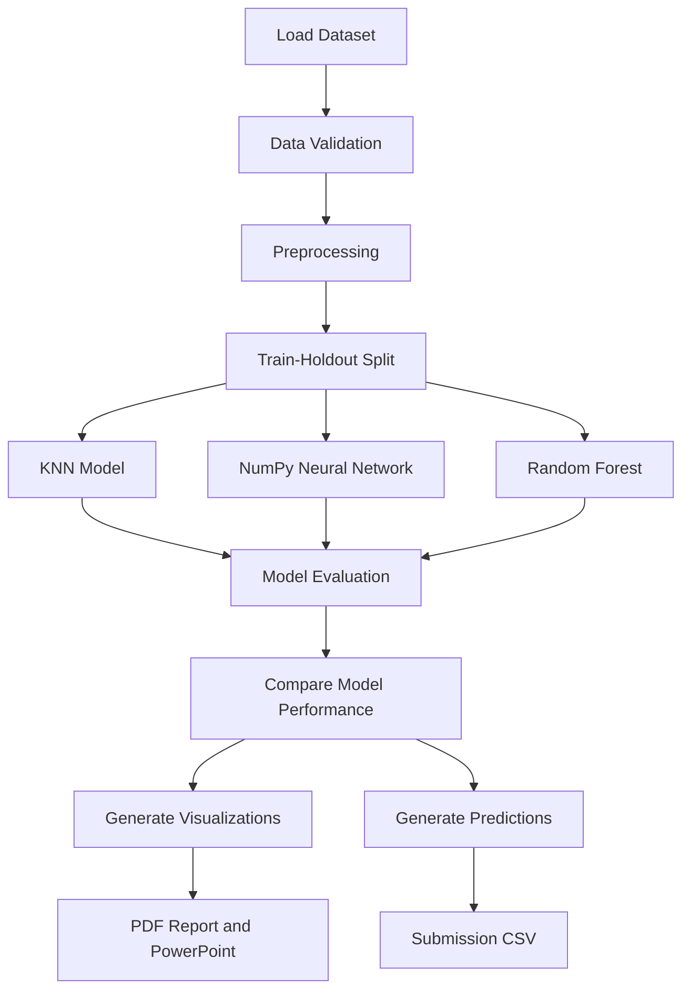

# 🏚️ Richter's Predictor — Earthquake Building Damage Classification

### Machine Learning Mini-Project | UE24CS352A

Predicting earthquake-related building damage using machine learning models and structural, material, and geographic features from the 2015 Gorkha earthquake in Nepal.


---

## 📌 Table of Contents

- [Project Overview](#-project-overview)
- [Problem Statement](#-problem-statement)
- [Objectives](#-objectives)
- [Dataset](#-dataset)
- [Machine Learning Models](#-machine-learning-models)
- [Project Workflow](#-project-workflow)
- [Project Structure](#-project-structure)
- [Technologies Used](#-technologies-used)
- [Installation and Setup](#-installation-and-setup)
- [How to Run the Project](#-how-to-run-the-project)
- [Results and Evaluation](#-results-and-evaluation)
- [Output Files](#-output-files)
- [Troubleshooting](#-troubleshooting)
- [Future Enhancements](#-future-enhancements)
- [References](#-references)
- [Team Members](#-team-members)

---

## 🌍 Project Overview

The 2015 Gorkha earthquake in Nepal caused extensive damage to buildings and infrastructure. Identifying the likely severity of building damage can help organize post-earthquake inspections and disaster-response activities.

**Richter's Predictor** is a machine learning project that classifies buildings into three damage grades using their structural characteristics, construction materials, geographic information, and other recorded attributes.

The project compares three machine learning approaches:

- K-Nearest Neighbours (KNN)
- Neural Network implemented using NumPy
- Random Forest Classifier

The project includes data preprocessing, model training, evaluation, visualization, prediction generation, and automated report and presentation creation.

> ⚠️ **Disclaimer:** This project is intended for academic learning and experimentation. Its predictions must not replace professional structural inspections or be used alone for building safety, evacuation, or emergency-response decisions.

## 🎯 Problem Statement

The objective is to predict the damage grade of a building based on its available features.

| Damage Grade | Description |
|---|---|
| Grade 1 | Low damage |
| Grade 2 | Medium damage |
| Grade 3 | Severe damage or near-complete destruction |

This is a **supervised multiclass classification problem**.

## 🎯 Objectives

- Understand and preprocess real-world earthquake building data.
- Handle numerical and categorical features.
- Implement and compare multiple machine learning models.
- Evaluate model performance using appropriate classification metrics.
- Analyze confusion matrices and feature importance.
- Generate predictions for the competition test dataset.
- Automate the generation of evaluation reports and presentation slides.
- Maintain a reproducible and organized ML workflow.

## 📊 Dataset

The project uses the dataset from the DrivenData competition:

**Richter's Predictor: Modeling Earthquake Damage**

Dataset link: https://www.drivendata.org/competitions/57/nepal-earthquake/data/

Download the required CSV files from the competition page. Sign-in and acceptance of the competition terms may be required.

### Dataset files

| File | Description | Records |
|---|---|---:|
| `train_values.csv` | Building features for training | 260,601 |
| `train_labels.csv` | Building damage labels | 260,601 |
| `test_values.csv` | Building features for prediction | 86,868 |

The feature dataset contains 38 input features and a building identifier. The target dataset contains the building identifier and `damage_grade`.

### Feature categories

The dataset contains information about:

- **Geographic features:** Geographic level 1, level 2, and level 3 identifiers.
- **Building structure:** Number of floors, building age, building area, and height-related characteristics.
- **Construction materials:** Foundation, roof, ground floor, and other construction attributes.
- **Structural indicators:** Superstructure types and other building characteristics.
- **Additional attributes:** Secondary building uses and other recorded properties.

### Dataset setup

Create a folder named `data` in the project root and place the downloaded files inside it.

```text
data/
├── train_values.csv
├── train_labels.csv
└── test_values.csv
```

**Note:** Raw datasets are excluded from Git version control. Download them separately and follow the competition's data-use terms.

## 🧠 Machine Learning Models

### 1. K-Nearest Neighbours (KNN)

KNN classifies a building based on the labels of nearby examples in feature space.

**Implementation includes:**
- Categorical feature encoding.
- Feature scaling.
- Feature selection using `SelectKBest`.
- Distance-based classification.

**Purpose:** Establish a baseline for comparison with more complex models.

### 2. Neural Network using NumPy

The project implements a two-layer neural network using NumPy rather than a deep-learning framework.

**Implementation includes:**
- Forward propagation.
- Hidden-layer sigmoid activation.
- Softmax output layer.
- Mini-batch training.
- L2 regularization.
- Training-loss tracking.

**Purpose:** Explore how a neural network learns nonlinear relationships in building data.

### 3. Random Forest Classifier

Random Forest combines multiple decision trees to improve predictive performance.

**Implementation includes:**
- Categorical feature preprocessing.
- Ensemble-based classification.
- Hyperparameter tuning using GridSearchCV.
- Feature-importance analysis.

**Purpose:** Learn nonlinear relationships and interactions among structural, geographic, and construction features.

## 🔄 Project Workflow



### Workflow explanation

1. Load the training features, training labels, and test features.
2. Validate the data and prepare the input features.
3. Encode categorical features and scale numerical features where appropriate.
4. Split the labelled data into training and holdout sets.
5. Train KNN, the NumPy neural network, and Random Forest.
6. Evaluate the models using classification metrics.
7. Save model comparisons, confusion matrices, and feature-importance plots.
8. Select a model for generating predictions.
9. Generate the submission CSV, PDF report, and PowerPoint slides.

## 📁 Project Structure

```text
nepal-earthquake-damage/
│
├── data/
│   ├── train_values.csv
│   ├── train_labels.csv
│   └── test_values.csv
│
├── data_synth/
│   └── Synthetic data for testing
│
├── src/
│   ├── data.py
│   ├── models.py
│   ├── neural_net.py
│   ├── train.py
│   └── run_all.py
│
├── tests/
│   └── make_synthetic.py
│
├── docs/
│   ├── build_writeup.py
│   ├── build_slides.py
│   └── common.py
│
├── results/
│   ├── metrics.json
│   ├── model_comparison.png
│   ├── confusion_matrices.png
│   ├── rf_feature_importance.png
│   └── nn_loss.png
│
├── requirements.txt
├── .gitignore
└── README.md
```

### Important files

| File | Responsibility |
|---|---|
| `src/data.py` | Loads datasets and defines preprocessing utilities |
| `src/models.py` | Defines the KNN, neural network, and Random Forest pipelines |
| `src/neural_net.py` | Implements the neural network using NumPy |
| `src/train.py` | Trains models, evaluates performance, and generates results |
| `src/run_all.py` | Coordinates the complete project workflow |
| `tests/make_synthetic.py` | Creates synthetic data for pipeline testing |
| `docs/build_writeup.py` | Generates the PDF report |
| `docs/build_slides.py` | Generates the PowerPoint presentation |
| `results/metrics.json` | Stores model evaluation results |

## 🛠️ Technologies Used

| Technology | Purpose |
|---|---|
| Python | Core programming language |
| NumPy | Numerical computations and neural network |
| Pandas | Dataset loading and manipulation |
| Scikit-learn | Preprocessing, classification, and evaluation |
| Matplotlib | Data visualization |
| ReportLab | PDF report generation |
| python-pptx | PowerPoint generation |
| Git and GitHub | Version control and collaboration |

## ⚙️ Installation and Setup

### Prerequisites

Install the following before starting:

- Python 3.10 or newer.
- pip package manager.
- Git.
- VS Code or another Python-compatible editor.
- The required competition CSV files.

### Step 1: Clone the repository

Replace the placeholders with your actual GitHub username and repository name.

```bash
git clone https://github.com/<YOUR-USERNAME>/<YOUR-REPOSITORY>.git
cd <YOUR-REPOSITORY>
```

If you already have the project on your computer, open the project folder directly in VS Code.

### Step 2: Create a virtual environment

**Windows PowerShell**

```powershell
py -m venv .venv
.\.venv\Scripts\Activate.ps1
```

If PowerShell blocks activation, use Command Prompt:

```bat
.venv\Scripts\activate.bat
```

**Linux or macOS**

```bash
python3 -m venv .venv
source .venv/bin/activate
```

### Step 3: Install dependencies

```bash
python -m pip install --upgrade pip
python -m pip install -r requirements.txt
```

### Step 4: Prepare the dataset

Download the competition dataset and place the CSV files inside the `data` folder.

Verify the filenames:

```text
data/train_values.csv
data/train_labels.csv
data/test_values.csv
```

### Step 5: Verify the environment

```bash
python --version
python -m pip list
```

Run subsequent commands from the project root, where `src/` and `requirements.txt` are located.

## ▶️ How to Run the Project

### Option 1: Run the complete pipeline

This is the recommended command for a full project run.

```bash
python -m src.run_all --data_dir data --team "Your Team | Section A"
```

The workflow runs the training and evaluation process, generates the available plots and metrics, and creates the report, slides, and predictions where supported by the pipeline and input files.

Replace `Your Team | Section A` with the actual team information.

### Option 2: Run a quick demonstration

```bash
python -m src.run_all --data_dir data --fast --team "Your Team | Section A"
```

The `--fast` option uses a smaller subset of the labelled data and a reduced model search to speed up testing.

**Important:** Quick-mode results are preliminary and must not be presented as full-dataset results.

### Option 3: Train and evaluate models only

```bash
python -m src.train --data_dir data
```

To specify a custom output directory:

```bash
python -m src.train --data_dir data --out results
```

To view supported options:

```bash
python -m src.train --help
```

### Option 4: Test the pipeline with synthetic data

Use this option to check basic pipeline execution without downloading the full competition dataset.

```bash
python tests/make_synthetic.py --out data_synth
python -m src.train --data_dir data_synth --out results_synth
```

Synthetic data is only for testing the workflow. Its evaluation scores do not represent the model's real-world predictive performance.

### Option 5: Generate the report and slides separately

After the training results have been saved:

```bash
python docs/build_writeup.py --results results --out writeup.pdf --team "Your Team | Section A"
```

Generate the presentation:

```bash
python docs/build_slides.py --results results --out slides.pptx --team "Your Team | Section A"
```

Check each script's help output if your local version uses different options.

## 📈 Results and Evaluation

The saved evaluation results from the current project run are summarized below.

| Model | Training Micro-F1 | Holdout Micro-F1 |
|---|---:|---:|
| KNN | 67.09% | 64.61% |
| Neural Network | 65.08% | 65.44% |
| Random Forest | 98.68% | **72.20%** |

**Best recorded holdout model:** Random Forest, with a micro-F1 score of 72.20%.

The Random Forest shows a substantial training-to-holdout performance gap, suggesting possible overfitting. Additional hyperparameter tuning and validation are recommended.

These are previously saved results, not a guarantee of performance on a fresh run or the official competition leaderboard.

### Evaluation metrics

- **Micro-F1:** Measures overall classification performance across all predictions.
- **Macro-F1:** Gives equal weight to each damage grade.
- **Precision:** Measures how often predictions for a grade are correct.
- **Recall:** Measures how many actual examples of a grade are identified.
- **Confusion matrix:** Shows the damage grades the model confuses.
- **Feature importance:** Identifies features that contribute to Random Forest predictions.
- **Training time:** Measures the computational cost of model fitting.

For this single-label multiclass problem, micro-F1 equals accuracy. Macro-F1 and class-specific recall are also important because performance can vary across damage grades.

## 📂 Output Files

After a successful run, check the `results/` folder.

| File | Description |
|---|---|
| `metrics.json` | Evaluation scores and model information |
| `model_comparison.png` | Training and holdout score comparison |
| `confusion_matrices.png` | Confusion matrices for the trained models |
| `rf_feature_importance.png` | Random Forest feature-importance chart |
| `nn_loss.png` | Neural network training-loss plot |
| `submission.csv` | Predictions for the competition test dataset |

The report and presentation scripts generate:

- `writeup.pdf` — project report.
- `slides.pptx` — PowerPoint presentation.

The exact files produced depend on the pipeline options and available input data.

### Submission CSV format

The generated competition submission is expected to contain:

```csv
building_id,damage_grade
```

Each test building receives a predicted damage grade of `1`, `2`, or `3`. Check the competition's current submission instructions before uploading it.

## 🐛 Troubleshooting

### 1. Module import error

If Python reports that the `src` module cannot be found, make sure you are running the command from the project root.

Use:

```bash
python -m src.run_all --data_dir data
```

### 2. Dataset file not found

Verify that all CSV files are inside the root-level `data/` folder and their filenames match the expected names.

### 3. Missing Python package

Activate your virtual environment and run:

```bash
python -m pip install -r requirements.txt
```

### 4. PowerShell activation issue

Use Command Prompt:

```bat
.venv\Scripts\activate.bat
```

### 5. Training is taking too long

Run the quick demonstration first:

```bash
python -m src.run_all --data_dir data --fast
```

Use the full pipeline when you are ready to obtain full-run results.

### 6. PDF or PowerPoint contains old results

Rerun the training pipeline successfully before regenerating the report and slides.

## 🚀 Future Enhancements

- Reduce Random Forest overfitting through systematic hyperparameter tuning.
- Evaluate macro-F1 and severe-damage recall.
- Compare gradient boosting algorithms such as XGBoost, LightGBM, and CatBoost.
- Explore better representations of geographic identifiers.
- Improve reproducibility through cross-validation and a separate final evaluation set.
- Add a simple interface for entering building features and displaying predictions.
- Evaluate the model's reliability and limitations before considering any real disaster-response application.

## 📚 References

1. DrivenData — Richter's Predictor: Modeling Earthquake Damage.  
   https://www.drivendata.org/competitions/57/nepal-earthquake/

2. Stanford CS229 — Application of Machine Learning Methods to Predict the Level of Buildings Damage in the Nepal Earthquake, 2021.

## 👥 Team Members

**Course:** UE24CS352A — Machine Learning Mini-Project

**Institution:** Add your institution name.

**Section:** Add your section.

**Team members:**
- Member 1 — Name / SRN
- Member 2 — Name / SRN
- Member 3 — Name / SRN
- Member 4 — Name / SRN

Replace these placeholders with the actual team details before submission.

---

<div align="center">

**Built for machine learning education and earthquake damage research.**

⭐ If you find this project useful, consider starring the repository.

</div>
