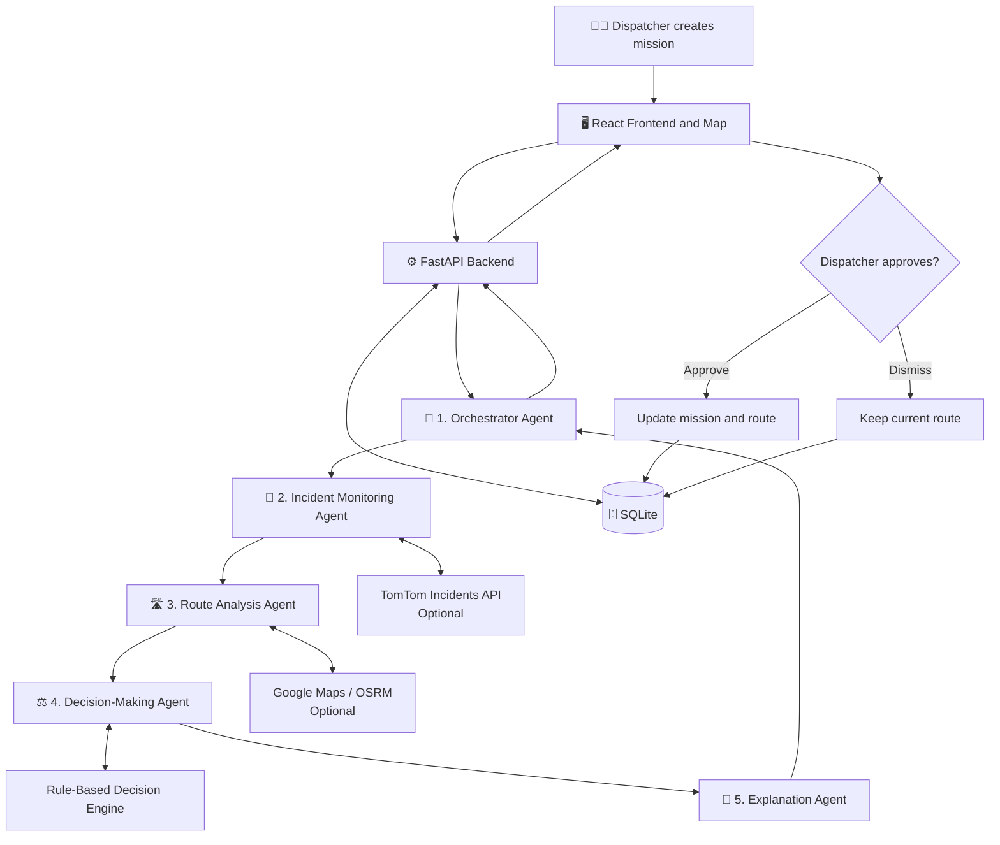

<div align="center">

# 🚑 GeoAgentic

### Emergency Vehicle Routing & Decision Support

**Monitor incidents · Compare routes · Explain decisions · Keep humans in control**

[](https://react.dev/)
[](https://fastapi.tiangolo.com/)
[](https://python.org/)
[](https://sqlite.org/)

</div>

---

## 🧭 Quick navigation

Click a section to jump directly to it.

- [🎯 Project overview](#-project-overview)
- [🤖 How the multi-agent system works](#-how-the-multi-agent-system-works)
- [🔄 End-to-end workflow](#-end-to-end-workflow)
- [🖥️ Dashboards](#️-dashboards)
- [🧰 Technology stack](#-technology-stack)
- [📁 Project structure](#-project-structure)
- [🚀 Run locally](#-run-locally)
- [🔌 Optional API integrations](#-optional-api-integrations)
- [🧪 Testing](#-testing)
- [⚠️ Scope and limitations](#️-scope-and-limitations)
- [🔭 Future improvements](#-future-improvements)

---

## 🎯 Project overview

GeoAgentic is a Bengaluru-focused emergency dispatch demo. It demonstrates how a **multi-agent workflow** can help a dispatcher respond when an emergency vehicle's route is affected by traffic, accidents, flooding, roadblocks, or other hazards.

Instead of only showing a map, GeoAgentic connects incident monitoring, route analysis, decision support, and explanations in one workflow. A human dispatcher reviews the recommendation and can approve or dismiss a proposed reroute.

### 💡 The problem it addresses

An emergency vehicle's original route may become unsuitable while it is travelling. Dispatchers need to know:

- 📍 What incident is affecting the route?
- 🛣️ Are alternative routes available?
- ⏱️ How do the available routes compare in ETA and distance?
- 🧠 Should the vehicle continue or should a reroute be recommended?
- 🗣️ Why is the system recommending this action?

GeoAgentic demonstrates a workflow for answering these questions using available route and incident data.

## 🤖 How the multi-agent system works

**This is the main part of GeoAgentic.** One Orchestrator Agent coordinates four specialised agents. Each has a separate responsibility and contributes to the final recommendation.

| Agent | What it does | What it produces |
|---|---|---|
| 🧭 **1. Orchestrator Agent** | Coordinates the mission workflow, starts the required stages, tracks progress, and combines results. | Coordinated workflow and final response |
| 🚨 **2. Incident Monitoring Agent** | Checks for incidents that may affect the active route. TomTom live data is available when configured; fallback/demo data may be used otherwise. | Relevant incident details |
| 🛣️ **3. Route Analysis Agent** | Examines the current route and available alternatives. Compares returned ETA, distance, and feasibility information. | Route options and comparison |
| ⚖️ **4. Decision-Making Agent** | Uses incident and route results with the implemented decision rules to recommend continuing or rerouting. | Continue/reroute recommendation |
| 💬 **5. Explanation Agent** | Presents the recommendation in understandable language and explains its supporting reasons when available. | Human-readable explanation |

> **Keep the roles clear:** the Orchestrator coordinates; Incident Monitoring checks incidents; Route Analysis compares routes; Decision-Making recommends an action; Explanation communicates the reason.

The application also has a **rule-based decision engine**. The agent workflow coordinates the stages, while the implemented rules and available data determine the recommendation. Optional Claude integration may improve explanation wording; not every agent should be described as an independent AI language model.

### 🗺️ Architecture at a glance



### 🔍 Agent hand-off: a simple example

Imagine an ambulance is travelling to a hospital and a roadblock is reported.

1. 🧭 **Orchestrator:** starts the incident-aware evaluation for the ambulance mission.
2. 🚨 **Incident Monitoring:** identifies the roadblock as potentially relevant to the active route.
3. 🛣️ **Route Analysis:** requests and compares available route alternatives.
4. ⚖️ **Decision-Making:** evaluates the returned information using the implemented decision logic.
5. 💬 **Explanation:** describes why an alternative may be preferable, based on available evidence.
6. 🧑‍✈️ **Dispatcher:** reviews the suggestion and approves or dismisses it.
7. 🔄 **Application:** updates the mission state if the reroute is approved.

The example illustrates the intended workflow. The actual result depends on the incident data, routing provider, and current implementation.

## 🔄 End-to-end workflow

**Mission → Incidents → Route analysis → Decision → Explanation → Human approval → Update**

| Step | Action |
|---|---|
| **1. 📝 Mission request** | Operator selects a vehicle, origin, destination, and priority. |
| **2. 🚨 Fetch incidents** | Incident Monitoring checks for route-relevant incidents. |
| **3. 🛣️ Analyse routes** | Route Analysis compares available route options. |
| **4. ⚖️ Make decision** | Decision-Making recommends continuing or rerouting. |
| **5. 💬 Explain** | Explanation Agent prepares a readable reason. |
| **6. 👀 Review** | The control room displays the recommendation. |
| **7. ✅ Approve or dismiss** | The dispatcher decides whether to accept the proposed reroute. |
| **8. 🔄 Update** | The application updates the mission when approved and continues the demo simulation. |

## 🖥️ Dashboards

- 🧑‍✈️ **Control Room:** create missions, monitor vehicles and incidents, review recommendations, and approve or dismiss reroutes.
- 🚑 **Driver:** view the assigned mission, route, vehicle status, and updates.
- 🛠️ **Admin:** review fleet information, system health, routing status, and available logs.

## 🧰 Technology stack

| Area | Technology | Purpose |
|---|---|---|
| 🖥️ Frontend | React 18, Vite, JavaScript, CSS | Dashboards and user interaction |
| 🗺️ Mapping | Leaflet, React-Leaflet | Map and route visualisation |
| ⚙️ Backend | FastAPI, Uvicorn | API and backend operations |
| ✅ Validation | Pydantic | Validate API requests and responses |
| 🗄️ Data access | SQLAlchemy, SQLite | Store and access demo application data |
| 🤖 Agent workflow | LangGraph-based workflow | Coordinate specialised decision stages |
| 🧠 Decision logic | Python rule-based engine | Support continue/reroute decisions |
| 🚨 Incidents | TomTom API (optional) | Live traffic incidents when configured |
| 🛣️ Routing | Google Maps Directions / OSRM (optional) | Routes and alternatives |
| 💬 Explanation | Templates; Claude optional | Operator-readable explanations |
| 🧪 Testing | pytest | Backend tests |

## 📁 Project structure

```text
Geoagentic/
├── README.md
├── schema.sql
├── start.bat
├── start.sh
├── backend/
│   ├── .env.example
│   ├── requirements.txt
│   ├── geoagentic.db
│   ├── app/
│   │   ├── main.py             # FastAPI entry point
│   │   ├── config.py           # Environment settings
│   │   ├── database.py         # Database setup
│   │   ├── models.py           # Database entities
│   │   ├── schemas.py          # API validation schemas
│   │   ├── routing.py          # Route generation
│   │   ├── decision_engine.py  # Decision rules
│   │   ├── simulation.py       # Vehicle movement
│   │   ├── traffic_monitor.py  # Incident checks
│   │   ├── agents.py           # Agent workflow
│   │   ├── live.py             # Live map/traffic access
│   │   └── places.py           # Built-in place data
│   └── tests/
└── frontend/
    ├── package.json
    └── src/
```

## 🚀 Run locally

### ✅ Requirements

- Python 3.10+
- Node.js 18+
- npm

### 1. 📥 Clone the repository

```bash
git clone https://github.com/ssananaaz2025/Geoagentic.git
cd Geoagentic
```

### 2. 🐍 Set up the backend

**Windows PowerShell**

```powershell
cd backend
python -m venv .venv
.\.venv\Scripts\Activate.ps1
pip install -r requirements.txt
Copy-Item .env.example .env
```

**Linux / macOS**

```bash
cd backend
python3 -m venv .venv
source .venv/bin/activate
pip install -r requirements.txt
cp .env.example .env
```

### 3. ▶️ Start the backend

Run from the `backend` directory:

```bash
uvicorn app.main:app --reload --port 8000
```

- 📘 API documentation: http://127.0.0.1:8000/docs
- ❤️ Health check: http://127.0.0.1:8000/api/health
- 🔌 Configuration status: http://127.0.0.1:8000/api/config/status

Check these endpoints against the version you are running.

### 4. 🌐 Start the frontend

Open a **second terminal**:

```bash
cd frontend
npm install
npm run dev
```

Open the local URL shown by Vite, commonly http://localhost:5173.

### ⚡ Optional: helper scripts

From the project root:

**Windows**
```powershell
.\start.bat
```

**Linux / macOS**
```bash
chmod +x ./start.sh
./start.sh
```

## 🔌 Optional API integrations

GeoAgentic is designed to run with fallback behaviour when external keys are not configured. Live results depend on valid credentials, provider availability, and the current implementation.

Edit `backend/.env`:

```dotenv
DATABASE_URL=sqlite:///geoagentic.db

GOOGLE_MAPS_API_KEY=
GOOGLE_MAPS_REGION=in
TOMTOM_API_KEY=
ANTHROPIC_API_KEY=
CLAUDE_MODEL=claude-sonnet-5-5

ROUTING_PROVIDER=auto
OSRM_BASE_URL=https://router.project-osrm.org
GOOGLE_MAPS_TIMEOUT_S=3
OSRM_TIMEOUT_S=2.5
```

Use the exact variable names supported by your current `.env.example` and `config.py`.

- 🚨 **TomTom:** live traffic incident retrieval when configured and implemented.
- 🗺️ **Google Maps:** road-route results when configured and available.
- 🛣️ **OSRM:** alternative routing service.
- 💬 **Claude:** optional explanation phrasing.

The documented intended `auto` routing order is Google Maps → OSRM → mock route fallback. Confirm this behaviour in the version you run.

🔐 **Security:** never commit real API keys. Keep them in your local `.env` file and ensure `.env` is excluded by `.gitignore`.

## 🧪 Testing

From the `backend` directory, with the virtual environment active:

```bash
pytest -q
```

### Suggested scenarios to validate

- [ ] 📝 Create a mission and confirm it appears in the control room.
- [ ] 🚨 Inject an accident, traffic, flood, or roadblock.
- [ ] 🔎 Check whether incident monitoring identifies relevant incidents.
- [ ] 🛣️ Verify route alternatives or fallback behaviour.
- [ ] ⚖️ Review the continue/reroute recommendation.
- [ ] 💬 Check that the explanation matches the decision.
- [ ] ✅ Approve a reroute and verify the mission state changes.
- [ ] ❌ Dismiss a recommendation and verify it is not accepted as a reroute.
- [ ] 🔌 Disable API keys and verify fallback behaviour.

Only mark a scenario as passed after testing it against the current code.

## ⚠️ Scope and limitations

- 📍 The demo validates coordinates within a Bengaluru-area boundary.
- 🚗 Vehicle movement and some incidents can be simulated.
- 🌐 Live incidents and road routes depend on external providers.
- 🗺️ Mock routes may not follow real roads or live traffic.
- ⏱️ ETA and route feasibility are estimates.
- 🧠 Decision quality depends on available data and implemented rules.
- 💬 Optional language-model explanations may be incomplete or incorrect.

**GeoAgentic is a development and research demo, not a production emergency-dispatch system. Do not use it to direct real emergency vehicles.**

## 🔭 Future improvements

- 📊 Measure time from incident detection to recommendation.
- 🛣️ Compare route and ETA quality against a baseline.
- 🧪 Compare multi-agent workflow results with a single rule-based pipeline.
- 🧾 Record agent inputs, outputs, traces, and failures for reproducible research.
- 🎯 Evaluate recommendation correctness across controlled scenarios.
- 🛡️ Improve confidence reporting and handling of missing or stale incident data.

These are possible future extensions, not claims of existing functionality.

---

## 🔗 Repository

**GeoAgentic — Emergency Vehicle Control Room**

[github.com/ssananaaz2025/Geoagentic](https://github.com/ssananaaz2025/Geoagentic)

<div align="center">

**🚨 Monitor incidents · 🛣️ Compare routes · 💬 Explain decisions · 🧑‍✈️ Keep the dispatcher in control**

</div>
